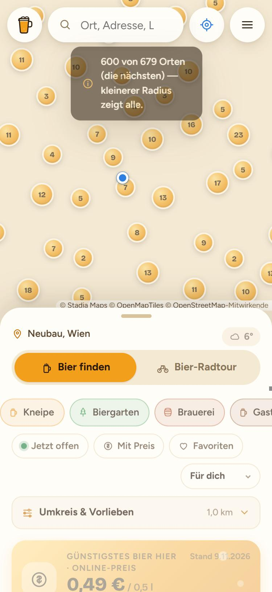
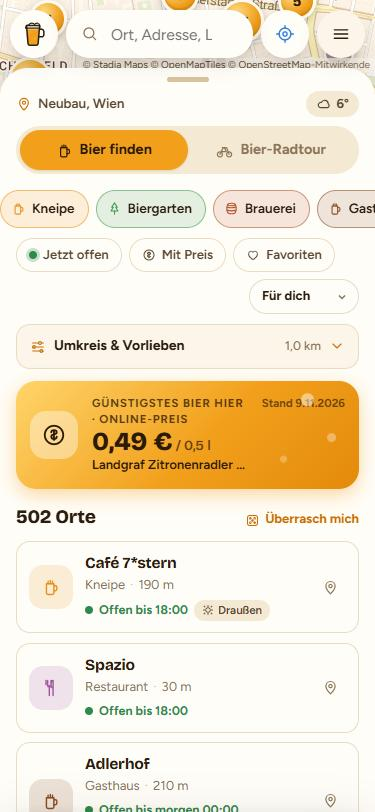
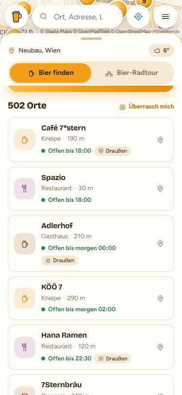
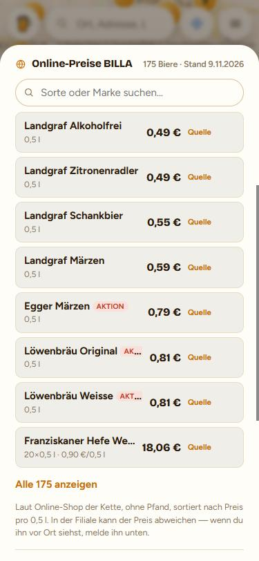
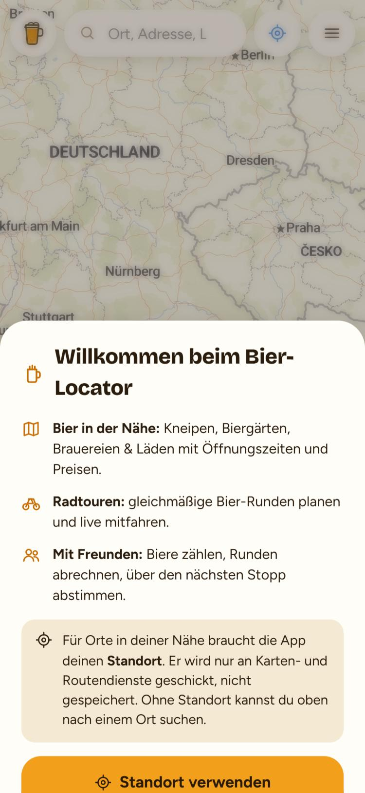
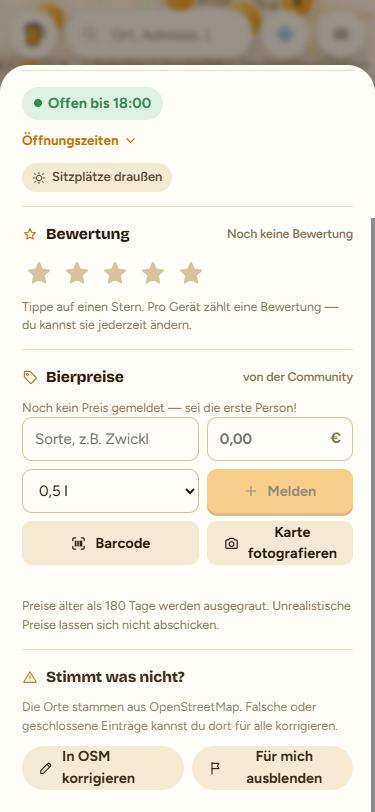
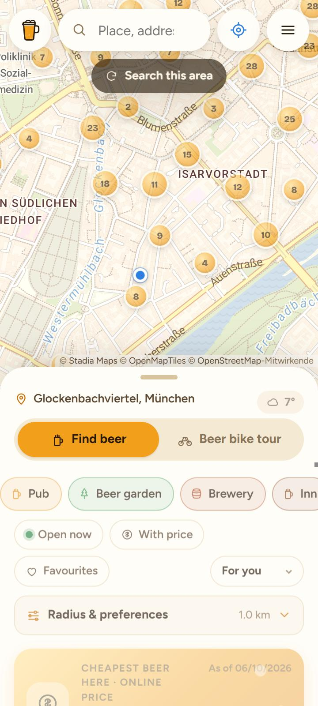
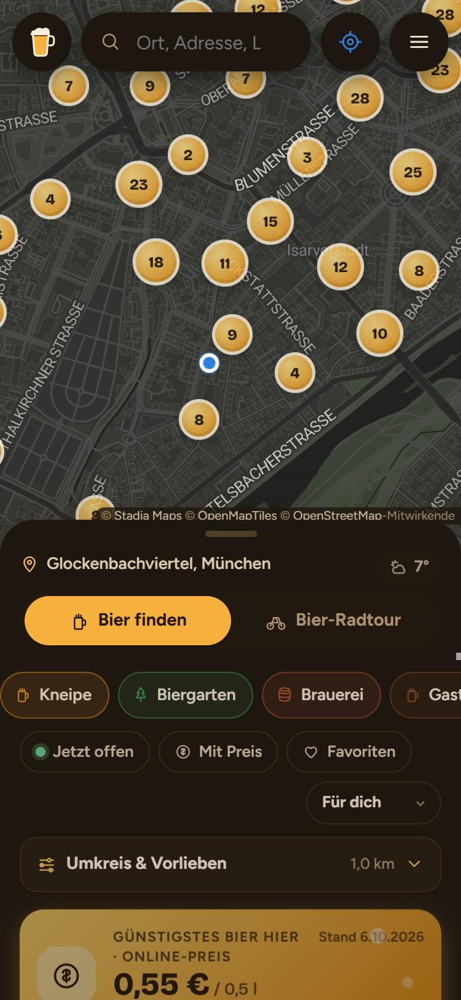
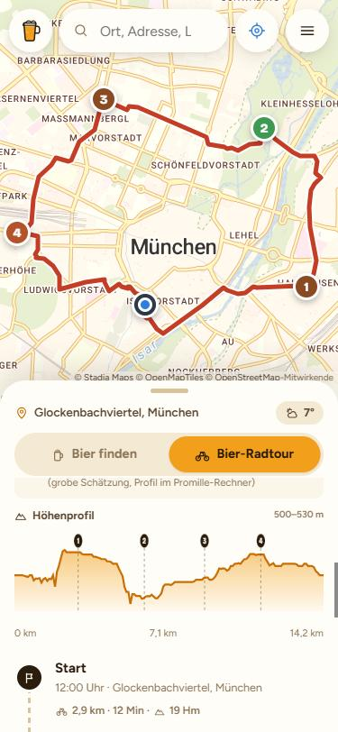
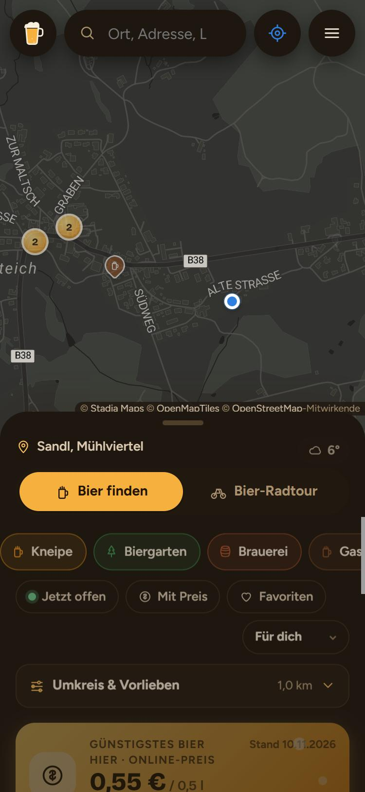

# Audit Bier-Locator (Stand 15.11.2026, v4.3.0)

Geprüft im Browser bei 375×812 und 360×800, hell und dunkel, Deutsch und Englisch, ohne GPS
(Standort gesetzt). Orte: Wien-Neubau, München-Glockenbach, Zürich-Langstrasse, Berlin-Neukölln,
Sandl im Mühlviertel. Dazu eine echte BRouter-Tour und die Browser-Tests (43/43 grün).

Nicht geprüft: 412×915, echtes Android-Gerät (TWA), Live-Tour unterwegs, „Meine Runde“ mit mehreren
Geräten. `js/tour/*` und `supabase/*.sql` habe ich nur überflogen. Vor jeder Änderung dort lese ich sie ganz.

## Das Wichtigste in fünf Sätzen

1. Der Startbildschirm zeigt Filter statt einer Antwort: Bei halbem Sheet ist **kein einziger Ort** zu sehen.
2. Die Liste ist Rauschen: 400 bis 500 Treffer im 1-km-Umkreis, über die Hälfte Restaurants.
3. Die Preisaussage stimmt oft nicht: „Günstigstes Bier“ ist ein Radler oder alkoholfrei, und in keiner
   der fünf Gegenden gab es auch nur einen Kneipenpreis.
4. Der Look ist sauber, aber austauschbar: 24 Schriftgrößen, 20 Radius-Werte, goldene Verläufe mit Glitzer.
5. Die Radtour ist das Beste an der App und bleibt, wie sie ist.

## 1. Die Antwort fehlt

| Befund | Beleg |
|---|---|
| Halbes Sheet zeigt Standort, Reiter, 11 Typ-Chips, 3 Schalter, Sortierung, „Umkreis & Vorlieben“ und die Preiskarte. Der erste Ort beginnt unterhalb des Bildschirms. |  |
| Auch voll ausgezogen kommt der erste Ort erst bei zwei Dritteln der Höhe. |  |
| Toast „600 von 679 Orten …“ liegt über der Karte (Wien, Zürich). Er beschreibt ein Problem der App, nicht des Nutzers. | `js/ui/finder.js:141` |

Treffer bei 1 km: Wien 502, Zürich 497, München 454, Berlin 403, Sandl 6. Ein fester Radius passt
weder in die Stadt noch aufs Dorf.

In den ersten 120 Zeilen in Wien: 73 Restaurants, 28 Kneipen, 12 Gasthäuser, 1 Brauerei. Platz 2 ist
ein Restaurant in 30 m, Platz 5 ein Ramen-Laden. Grund: In der Sortierung zählt Nähe bis 40 Punkte,
der Typ trennt Kneipe und Restaurant nur um etwa 8 (`finder.js:165–185`).

Die Zeile selbst () braucht drei Textzeilen und sagt trotzdem nicht, wie
lange man hingeht. Meter statt Gehminuten, der Pin rechts doppelt den Tipp auf die Zeile. Bei 26 bis 78
der ersten 120 Orte steht „Öffnungszeiten unbekannt“, gleich laut wie „Offen“.

## 2. Wo Daten lügen

| Befund | Beleg |
|---|---|
| „Günstigstes Bier hier: 0,49 €, Landgraf Zitronenradler“ in Wien, „Pittinger Radler Zitrone“ in Sandl. Radler wird nicht aussortiert. | `js/chainPrices.js:88` |
| In der BILLA-Liste steht „Landgraf Alkoholfrei“ ganz oben. |  |
| Zürich: Migros und Migrolino zeigen CHF 2.27 als Bierpreis. Migros verkauft keinen Alkohol, alle 111 Migros-Einträge sind alkoholfrei. | `data/chain-prices.json` |
| Rund 500 der 1.625 Preise sind kein Bier im engeren Sinn (287 alkoholfrei, 231 Radler/Mischgetränke, teils doppelt gezählt). Die vermeintlichen 75 Dubletten sind Paare aus Normal- und Aktionspreis desselben Produkts und gewollt (nachgeprüft 17.11.). | Auswertung |
| Echte Abdeckung: AT 1.359, CH 158 (davon 111 alkoholfrei), DE 108. | Auswertung |
| Kein einziger Community-Preis in einer Kneipe an allen fünf Orten. Das Preisschild in der Liste gibt es praktisch nur bei Supermärkten. | Durchklicken |
| Community-Preise werden überall mit „€“ gezeigt und gemeldet, auch in Zürich (`fmtEuro`, Feld „Preis in Euro“). | `js/ui/detail.js:92,140` |
| Für die Preiskarte werden Franken und Euro als nackte Zahlen verglichen, Franken nur notdürftig nach hinten sortiert. | `finder.js:220` |
| OSM-Tag `brewery=no` erscheint als Etikett „no“ (Soulmate Bar, Wien). | `finder.js:341` |
| Derselbe Ort doppelt in der Liste (München ’72, als Punkt und als Fläche in OSM). | Durchklicken |
| Die Scraper geben sich als Chrome aus, statt sich als Projekt zu erkennen zu geben. | `scripts/scrapers/common.py:13` |
| Fällt eine Kette auf wenige Treffer, merkt das niemand. Nur bei null bleibt die alte Datei. | `scripts/scrape_prices.py` |

## 3. Bedienung

- **Tippflächen unter 44 px:** Schalter 35, Typ-Chips 38, Reiter 40, Icon-Knöpfe 40, „Überrasch mich“ 19.
- **Android-Zurück:** Es gibt keinerlei Verlaufsbehandlung (`pushState`/`popstate` kommt im Code nicht vor).
  In der TWA schließt Zurück also die App statt den Dialog.
- **Versteckte Geste:** „Doppeltipp = nur dieser Typ“ steht nur unter „Über die App“.
- **Sheet voll:** Bei 375×812 bleibt die Kopfzeile frei (10 px Abstand), die Karte ist aber komplett weg.
  Die Ortsansicht ist ein eigener Dialog, der die Kopfzeile überdeckt. Dein Eindruck dürfte von dort kommen.
- **Erster Start** ist ein Feature-Katalog mit drei Punkten plus Hinweiskasten plus zwei Knöpfen.
  
- **Preis melden:** Freitext, Betrag, Gebinde, dazu drei Knöpfe. Keine Vorschläge aus dem, was die
  Kette führt oder dort schon gemeldet wurde. 
- **Fehler beim Start:** `Invalid LatLng (NaN, NaN)` aus `map.js:73`, wenn die Karte beim Laden noch keine
  Größe hat (bei mir im Hintergrund-Tab, 46-mal). Am Gerät noch nachzuprüfen, braucht aber so oder so einen Schutz.
- Englisch ist bei 360 px vollständig, kein Überlauf. 

## 4. Look

- `styles.css`: 24 verschiedene Schriftgrößen (9,5 bis 46 px, viele halbe Pixel), 20 Radius-Werte neben
  4 Tokens (36-mal `99px`), über 20 freihändige Schatten neben 3 Tokens, 12 Verläufe.
- 33 Keyframes, 64 Animationsstellen (nicht 80). Marker poppen einzeln auf, die Preiskarte glitzert.
- Die Preiskarte ist ein goldener Verlauf mit Münz-Icon: der generischste Baustein der App und
  zugleich der mit der falschesten Aussage.
- Marker: alle Typen gleich groß und gleich laut, in der Stadt sieht man fast nur gelbe Cluster-Münzen
  mit Glanzlicht. 
- Dunkle Karte ist neutralgrau und passt nicht zur warmen Palette.
- Emojis in Texten von 9 JS-Dateien, Gedankenstriche in fast jedem längeren Satz, Klammer-Erklärungen
  in drei Tour-Schaltern.

## 5. Was gut ist und so bleibt

- **Radtour:** München, Rundtour 15 km, 4 Stopps → 14,2 km (−5 %), Etappen 2,6 bis 3,0 km, alle Stopps
  bei Ankunft offen, lauter echte Bierorte. Das ist die Messlatte für spätere Vergleiche.
  
- Palette, Schriften, Glas-Logo. Overpass mit mehreren Servern und Cache. Plausibilitätsgrenzen
  in App und Datenbank sind gleich (0,30 bis 15 € bzw. 0,25 bis 4 € im Kasten). Tests laufen bei jedem Push.
- Dorf funktioniert: 6 Orte, drei Gasthäuser vorn. 

## Plan

Ein PR pro Zeile, Merge erst nach deinem OK. Reihenfolge wie von dir vorgegeben, mit einer Änderung:
Die falschen Preisaussagen sind live und klein zu beheben, die ziehe ich vor.

| # | PR | Inhalt | Bewusst nicht |
|---|---|---|---|
| 1 | Audit, Plan, Leitlinie | Dieses Dokument, `docs/design.md` | |
| 2 | Ehrliche Preise (klein) | Radler und Alkoholfreies nie als „günstigstes Bier“, `brewery=no`, Test dafür | Kategorien im Datensatz (kommt in 6) |
| 3 | Design-Fundament | Tokens durchziehen, Typo-Skala, Marker und Cluster, Leer-/Fehler-/Offline-Zustände, Texte DE+EN, Animationen ausdünnen, Übersetzungs-Test | Neuer Kartenstil mit Vektorkacheln (wäre eine neue große Abhängigkeit) |
| 4 | Startbildschirm und Liste | Bierorte zuerst, Radius nach Dichte, Zeile mit Gehminuten, Filter hinter einen Knopf, Preiskarte nur mit passendem Preis, Toast weg, Zurück-Taste, 44 px, Dubletten | Neue Reiter |
| 5 | Länder und Währungen | `js/countries.js` als eine Quelle, Währung pro Ort, Grenzen pro Währung, `006_….sql`, Tests | Neue Länder selbst |
| 6 | Datenqualität | Kategorie pro Preis (Bier, Radler, alkoholfrei, Craft), Namen normalisieren, Dubletten, Scraper-Bericht mit Vorwochenvergleich, ehrlicher User-Agent | |
| 7 | Neue Quellen | Erst DE und CH auffüllen, dann zwei Nachbarländer. Jede Quelle vorher in `docs/sources.md` geprüft | Alles mit Bot-Schutz |
| 8 | Praktisches | Kandidaten: Bier-Suche („Wo gibt’s Zipfer?“), Kasten/Sixpack mit Pfand, Spät-Modus, Menü aufräumen | Happy Hour (siehe unten) |
| 9 | Technik | Preisdatei pro Land, Offline-Anzeige, große Dateien teilen, README, Datenschutz | |

Einschätzungen zu Abschnitt 4 deines Briefings:

- **Happy Hour als Community-Meldung** würde ich streichen. Es gibt heute null Kneipenpreise. Eine
  zweite Meldeart, die noch mehr Pflege braucht, bleibt leer.
- **Preis melden in zwei Taps** ist dagegen der wichtigste Hebel der ganzen App. Ohne Kneipenpreise
  bleibt „was kostet’s?“ unbeantwortet. Das gehört in PR 4, nicht ans Ende.
- **Open-Graph-Vorschau** für geteilte Touren geht auf GitHub Pages nicht pro Link (die Daten stehen im
  `#`-Teil, den kein Vorschau-Dienst sieht). Machbar ist eine gute allgemeine Vorschau für die App.
- **Kartenstil passend zur Palette:** Mit den Rasterkacheln von Stadia geht nur eine Tönung. Ein eigener
  Stil hieße Vektorkacheln plus MapLibre (rund 800 KB). Ich bleibe bei Raster und stimme die Tönung ab.
